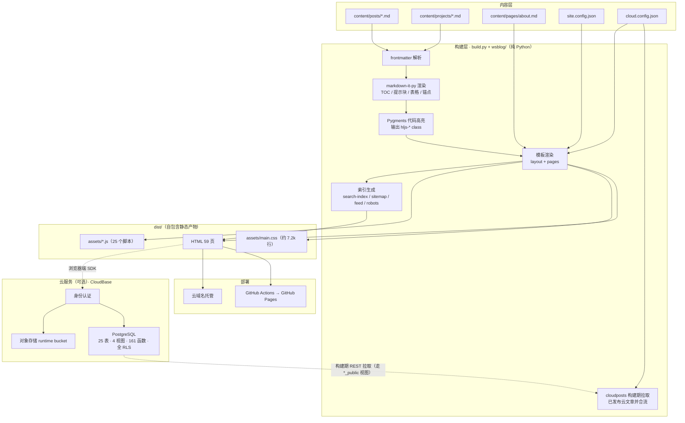

# WS Blog · 网站详细介绍

> 一个 Markdown 驱动、纯 Python 构建的技术博客站点。  
> 深色技术风、零运行时框架、构建产物完全自包含；可选接入云服务，获得账号、评论与在线发文能力。

---

## 1. 概览

| 项目   | 说明                                                        |
| ---- | --------------------------------------------------------- |
| 站点名称 | WS Blog                                                   |
| 定位   | 个人技术分享与交流博客                                               |
| 内容形态 | Markdown 文件 + 可选的云端在线文章                                   |
| 构建方式 | 自研静态站点生成器，纯 Python（仅 2 个依赖）                               |
| 前端形态 | 原生 HTML / CSS / JavaScript，无框架、无构建期 JS 打包                 |
| 页面数量 | **59 个页面产物**（含静态文章 / 项目详情 / 标签聚合 / 作者主页等自动生成页）              |
| 源码规模 | 约 **35k 行首方代码**（Python ≈8.6k + JS ≈18.7k + CSS ≈7.2k，不含第三方库） |
| 回归护栏 | **16 个探针、766 项断言**接入 CI（`tests/run-tests.mjs`）             |

### 线上地址

| 地址                                                     | 性质                          | 能力                                |
| ------------------------------------------------------ | --------------------------- | --------------------------------- |
| <https://ws-blog.app.workbuddy.host/>                  | 云域名（**规范地址**，canonical 指向它） | 全功能：静态内容 + 登录 / 评论 / 投稿 / 后台       |
| <https://zhongwanshun1225.github.io/ws-personal-blog/> | GitHub Pages（镜像）             | 打开即自动跳到云域名同路径                     |

> 两处内容同源、同一份构建产物。GitHub Pages 通过 `Actions` 在每次推送 `main` 后自动构建发布；  
> 云域名由云服务托管，构建产物在部署沙箱内自动生成。
>
> **镜像为什么跳转**：云端按 Origin 精确放行 —— `publishableKey` 只对 `ws-blog.app.workbuddy.host` 生效，
> 其他来源（含 `github.io`）请求云接口一律 `403`（实测；免费套餐也无法把域名加进环境安全域名白名单）。
> 也就是说镜像域名上登录 / 评论 / 点赞 / 投稿 / 后台全部不可用。与其留一个半残的副本，不如让访问者
> 直接落到全功能域名。跳转由 `site.config.json` 的 `mirror` 段驱动（渲染成 `<head>` 里的一段内联脚本，
> 尽早执行、保留路径与查询串）；带 `?mirror=off` 访问可停留原处。

---

## 2. 设计理念

**① 内容即文件，不引入数据库依赖。**  
文章就是 `content/posts/*.md`，项目就是 `content/projects/*.md`。写文章 = 丢一个文件，  
不需要登录后台、不需要 CMS。版本历史由 Git 天然提供，迁移和备份就是复制目录。

**② 构建系统自研且只有两个依赖。**  
`markdown-it-py`（Markdown 渲染）+ `Pygments`（代码高亮），都是纯 Python 包，无需编译。  
不依赖 Hexo / Hugo / Next.js，构建过程完全可控、可读、可改。

**③ 零运行时框架，产物完全自包含。**  
输出的 HTML 直接可用，首屏无 JS 依赖；所有资源为相对路径，可托管在任意路径下（含子目录）。  
唯一随站点打包的第三方库是 Cloud SDK（`src/vendor/cloud-sdk.js`，用于账号 / 评论 / 后台），  
**不依赖任何外部 CDN**——离线环境、大陆网络环境下同样稳定。

> 注：`src/vendor/` 下另有 `marked.min.js` / `highlight.min.js` / `mermaid.min.js` / `katex` 几个文件，
> 它们是**早期版本留下的历史遗留**，当前构建与页面均不再引用（Markdown 在 Python 侧由
> `markdown-it-py` 渲染、代码高亮由 `Pygments` 输出 `hljs-*` class，客户端只负责渲染**云文章正文**，
> 走的是 `cloud-markdown.js`）。留作参考，不参与产物。

**④ 增强能力是「可选」的，而不是「必须」的。**  
云能力（账号 / 评论 / 后台）通过 `cloud.config.json` 开启。删掉该文件并把 `build.py` 里的  
`cloud=True` 改为 `False`，站点立即退化为纯静态博客，其余功能不受影响。

---

## 3. 功能总览

### 3.1 访客侧（无需登录）

**首页**

- Hero 区：问候语、主标题、口号、简介、双按钮（看项目 / 关于我）
- 实时统计：技术文章数、项目作品数、技术标签数（构建期自动统计）
- 文章列表（置顶优先 + 时间倒序）+ 标签筛选条
- 精选项目区

**文章**

- 列表页 / 首页卡片，含摘要、日期、阅读时长、标签
- 详情页：目录（TOC，右侧悬浮 + 滚动高亮）、阅读进度条、返回顶部
- 代码块：构建期完成语法高亮（打开即有色，无闪烁、无额外请求）+ 一键复制
- 提示块：GitHub 风格 `> [!NOTE]` / `[!TIP]` / `[!IMPORTANT]` / `[!WARNING]` / `[!CAUTION]`
- 表格自动加横向滚动容器；外部链接自动加图标；标题自动生成锚点
- 图片点击放大（灯箱）
- 上一篇 / 下一篇导航
- **相关文章推荐**（标签重合优先，无重合时按时间就近兜底）
- JSON-LD 结构化数据（BlogPosting）+ og / twitter 卡片

**内容发现**

- **站内搜索**：`Ctrl / ⌘ + K` 唤出（`/` 也可），客户端索引（已分片），支持标题 / 摘要 / 正文 / 标签多词匹配，  
  键盘上下选择 + 回车跳转
- **归档页**：按年份分组的全部文章时间线
- **标签页**：标签云总览 + 每个标签的独立聚合页
- **系列 / 合集**：`series.html` 汇总系列内的多篇文章
- **快捷键速查**：`shortcuts.html` 列出全站快捷键
- **邮件订阅**：`subscribe.html` 表单 + 确认流程（订阅者存 `subscribers`）与 RSS 双通道
- **RSS 订阅**：`feed.xml`
- **sitemap.xml** + `robots.txt`

**项目**

- 项目集页：精选区 + 全部卡片（技术栈标签、状态徽章、仓库 / 演示链接）
- 项目详情页：Markdown 正文 + 技术栈 + 外链

**其他**

- 关于页（Markdown 正文 + 技能栈 + 经历时间线）
- **隐私政策页**（`privacy.html`，正文在 Markdown，页脚有法律链接区，全站页面覆盖）
- 404 页面 + **离线兜底页**（Service Worker）
- **PWA / Service Worker**：静态资源缓存，改脚本时 `src/sw.js` 的 `VERSION` 需同步升位
- 深色技术风主题、完整响应式（移动端导航抽屉、移动端目录折叠为可展开卡片）
- 打印样式

### 3.2 账号与互动（登录后）

**登录 / 注册 —— 单一入口，按账号权限分流**

站点**不区分「用户入口」和「管理员入口」**，只有一个登录页。能做什么完全由账号本身决定：

| 登录的账号         | 登录后的走向                             |
| ------------- | ---------------------------------- |
| 普通账号          | 直接以普通用户身份进入（默认回到来源页）               |
| 管理员账号（邮箱白名单内） | 多一步「选择进入身份」：`以普通用户身份进入` 或 `进入后台管理` |

- 两种登录方式：**邮箱 + 密码**、**邮箱验证码**（新用户首次使用验证码登录时设置密码）
- 第三方登录：**Google / 微信**（云平台中转的 workbuddy 通道实测不可用，故未暴露）
- 管理员选择「普通用户」浏览后，随时可从右上角账号菜单切回后台；  
  直接打开 `/admin.html` 时守卫会自动切到管理员身份
- 登录状态变更实时反映在顶栏（`data-auth-slot` 插槽）
- **登录态闲置超时**：连续 5 分钟无任何**用户输入**（点击 / 移动 / 滚动 / 键盘 / 触摸，**不含后台轮询**）
  自动登出并跳回登录页说明原因；剩余 60 秒时先弹警告条并提供「继续使用」续期，避免写长文被静默踢出。
  登出前会主动触发草稿刷盘并留 600ms 宽限。登录页本身不启用，游客不受影响。

**文章互动**

- **点赞**、**收藏**（每篇文章独立，状态实时回显）
- **评论**：两级「楼中楼」结构，可回复 / 取消回复，支持删除自己的评论；
  可对评论**点赞 / 点踩**、**举报**；评论经**预审**（默认 `pending`，命中敏感词只打标记不自动隐藏）
- **阅读量统计**：每篇文章自动计数并展示（另有匿名 PV 上报，供后台统计面板）
- **站内通知**：评论 / 回复 / 投稿状态变更（通过 / 驳回 / 待审 / 下架）都会收到通知，顶栏有未读角标

**个人中心 `/account.html`**

- 昵称、头像（支持**直接上传**，也可填 URL；上传后可 Canvas 裁剪压缩）、个人简介
- **我的投稿**（状态徽章 + 驳回理由 + 编辑 / 阅读入口）
- 我的评论 / 我的点赞 / 我的收藏 视图
- **账号安全**：修改密码、**改邮箱**（站内申请 + 站后台处理，平台无改邮箱端点）、
  **两步验证 2FA**（TOTP）、登录设备管理（查看 / 踢出其他设备）
- **数据导出**（一键导出自己的全部数据）与**账号注销**（真删内容侧并把资料置墓碑；
  平台登录账号本身无法删除，界面如实告知）
- **拉黑用户**（被拉黑者看不到你的评论）、**阅读历史**
- 身份切换入口

**投稿 `/write.html`**（登录后可用，顶栏账号菜单「写文章」或在线文章页「我也要投稿」进入）

- Markdown 编辑器：预览渲染、插图上传、标签 / 摘要 / 自定义 slug
- **编辑器增强**：目录大纲、字数 / 阅读时长提示、快捷键与工具栏
- **本地草稿自动保存**（防抖 1200ms，切换标签 / 关页面强制刷盘，30 天过期；投稿页与后台共用）
- **定时发布**（设定 `publish_at`，到点自动可见）
- **修订历史与回滚**（列出各版本可一键恢复）
- **草稿预览分享链接**（生成带 `noindex` 的临时预览页，可随时吊销）
- 保存草稿（仅自己可见）或**提交审核**；待审核稿件可随时撤回
- 未通过的稿件显示站长给的理由，改完可重新提交
- 已发布的文章在本页只读（需站长下架后才能修改）；**若账号具备直发权限**（`can_publish`）改稿可直接生效，
  否则走「改稿待审」（写入影子列，主字段不动，线上不掉线）

**登录页**

- 邮箱 + 密码、邮箱验证码两种登录方式（首次验证码登录自动注册并设密码）
- **忘记密码**：邮箱获取验证码 → 设置新密码 → 自动登录（全程自助，管理员无法代改他人密码）

**阅读页（在线文章 `/post.html?slug=...`）**

- 客户端渲染 Markdown（sanitize + 高亮 + 锚点）、TOC、上下篇、互动区挂载

### 3.3 管理后台 `/admin.html`

后台共 **15 个标签页**（`data-admin-tab`），其中 `users` / `admins` / `data` / `audit` **仅管理员可见**
（普通用户侧无入口，前端守卫亦会拦截）：

| 标签页      | 能力                                                                                              |
| -------- | ----------------------------------------------------------------------------------------------- |
| 文章管理     | Markdown 在线编辑、**预览渲染**、保存草稿 / 保存并发布、**插入图片**（上传至云存储后插入 Markdown）、编辑与删除（可删任何人发的文章），列表含**作者列**与全部状态徽章；支持**勾选批量操作** |
| 内容审核     | 用户投稿队列（**待审核排最前**，附作者 / 邮箱 / 字数 / 摘要）；**通过**（立即发布）、**驳回**（填写理由，展示给作者）、**查看**（载入编辑器可改可发）、**下架**、删除；已处理列表保留审核记录与理由；**改稿待审**（已发布文章的修改稿，看新旧全文对比后通过 / 驳回） |
| 评论管理     | 全部评论列表（标注「回复 @xx」）、显示 / 隐藏、删除（可删任何人的评论）；支持批量操作                                      |
| 垃圾评论     | 命中敏感词或举报达阈值的评论队列，可批量删除 / 放行                                                                    |
| 举报与申请    | **评论举报**处理队列 + **邮箱变更申请**处理（平台无改邮箱端点，站内申请由后台落实）                                                 |
| 媒体库      | 已上传图片总览与管理（管理员视角；作者视角暂无）                                                                       |
| 统计与访问    | 增长趋势图（按日聚合）、热门文章 / 页面排行、访问分析 —— 数据来自匿名 PV 上报                                                  |
| 站点设置     | 站点标识（名称 / 副标题 / 描述 / 关键词 / ICP 备案号 / 联系邮箱）、公告条、维护模式、评论风控阈值 —— **在线修改即时生效**                     |
| 通知与邮件    | 站外通知总开关与渠道（Webhook / SMTP）、邮件与消息模板、**投递队列**（含重试状态）                                              |
| 数据与备份    | 导出全量 / 分项 JSON、备份快照清单、**自动备份**（启用 / 执行时刻 / 范围 / 保留份数 / 异地留存 Webhook 或 S3）                          |
| 用户       | 列表含邮箱 / 状态 / 角色 / 互动量 / 最近登录；**禁用 / 启用账号**、**设为 / 取消管理员**、**删除用户**（清空其评论、点赞、收藏并禁用）、**重置密码指引**（一键复制给用户） |
| 管理员      | 管理员邮箱白名单的添加 / 移除                                                                                |
| 操作日志     | 全站管理操作审计（谁在何时做了什么）                                                                             |
| 安全与健康    | worker 心跳状态（站外通知 / 备份）、系统自检项                                                                   |

**投稿与审核流**：普通用户在 `/write.html` 用 Markdown 写稿，只能保存**草稿**或**提交审核**（数据库 RLS 限定投稿状态只能是
draft / pending / rejected，想直接写 published 会被拒）。管理员在后台「内容审核」里通过（立即前台可见）或驳回（附理由）；
未通过的稿件作者可改后重投，已发布的文章作者只读、需联系管理员下架后才能改。管理员自己写的文章不受审核限制。

**关于密码**：登录密码由云平台以 bcrypt 加密托管（`auth.users.password`，`$2a$` 前缀），本站数据库不保存、后台也无法查看或代改；  
重置走登录页的「忘记密码」自助流程（邮箱验证码 → 设置新密码）。**被禁用的账号**仍可登录浏览，但无法评论、点赞、收藏或修改资料  
（数据库写策略统一加了 `is_active()` 校验，前端同时有提示条与操作拦截）。

**权限是两层的**：

1. 数据库层：所有敏感表开启 RLS，管理操作走 `SECURITY DEFINER` 函数，非管理员调用直接被数据库拒绝；
2. 前端层：页面守卫负责跳转与提示。

> 前端的守卫只是体验优化，**真正的边界在数据库**。

---

## 4. 站点地图

全站构建产物 **59 个 HTML 页面**（含静态文章、项目、标签聚合、作者主页等自动生成的页面）。
下表列主要入口：

| 路径                             | 页面      | 说明                              |
| ------------------------------ | ------- | ------------------------------- |
| `/index.html`                  | 首页      | Hero + 统计 + 文章列表 + 精选项目         |
| `/posts.html`                  | 在线文章    | 站长发布与审核通过的投稿，附「我也要投稿」入口         |
| `/post.html?slug=…`            | 在线文章详情  | 客户端渲染 Markdown + TOC + 上下篇 + 互动 |
| `/posts/<slug>.html`           | 文章详情    | 静态文章（`content/posts/` 下的 Markdown） |
| `/projects.html`               | 项目集     | 精选 + 全部项目                       |
| `/projects/<slug>.html`        | 项目详情    | 项目正文                            |
| `/authors/<owner_id>.html`     | 作者主页    | **只给有已发布文章的作者生成**（`profiles_public` 仅 `status='active'`，无 PII） |
| `/archive.html`                | 归档      | 按年分组的文章时间线                      |
| `/tags.html`                   | 标签云     | 全部标签总览                          |
| `/tags/<slug>.html`            | 标签聚合    | 单标签文章列表                         |
| `/series.html`                 | 系列      | 系列 / 合集总览                        |
| `/about.html`                  | 关于我     | 正文 + 技能 + 经历                    |
| `/subscribe.html`              | 订阅      | 邮件订阅表单 + RSS 入口                 |
| `/shortcuts.html`              | 快捷键     | 站点快捷键速查                         |
| `/privacy.html`                | 隐私政策    | 正文在 `content/pages/privacy.md`，改政策不用碰代码 |
| `/login.html`                  | 登录 / 注册 | 单一入口 + 身份选择 + 忘记密码              |
| `/write.html`                  | 写文章     | 用户投稿：Markdown 编辑器 / 预览 / 我的投稿   |
| `/account.html`                | 个人中心    | 资料 / 账号安全 / 我的投稿 / 评论 / 点赞 / 收藏 / 阅读历史 / 拉黑 / 数据导出 |
| `/notifications.html`          | 站内通知    | 评论、回复、投稿状态变更的通知列表                |
| `/admin.html`                  | 管理后台    | 15 个标签页（见 3.3）                   |
| `/preview.html?token=…`        | 草稿预览    | A4 的临时分享页，带 `noindex` 反收录        |
| `/404.html` · `/offline.html`  | 404 / 离线 | 未找到页面 / Service Worker 离线兜底      |
| `/feed.xml`                    | RSS     | 订阅源                             |
| `/sitemap.xml` · `/robots.txt` | SEO     | 站点地图与爬虫规则                       |
| `/search-index.json`           | 搜索索引    | 客户端搜索数据（已分片）                    |

---

## 5. 内容模型

### 文章 `content/posts/*.md`

| 字段        | 必填 | 说明                                  |
| --------- | -- | ----------------------------------- |
| `title`   | 建议 | 不写则用文件名                             |
| `date`    | 建议 | 不写则用文件修改时间                          |
| `tags`    | 可选 | `[a, b]` / `a, b` / 多行 `- a` 三种写法均可 |
| `summary` | 可选 | 不写则自动截取正文前 110 字                    |
| `slug`    | 可选 | 自定义 URL，默认用文件名                      |
| `pinned`  | 可选 | 置顶显示                                |
| `draft`   | 可选 | 草稿，正式构建时跳过                          |
| `updated` | 可选 | 更新时间                                |

### 项目 `content/projects/*.md`

| 字段                               | 说明                    |
| -------------------------------- | --------------------- |
| `title` / `description` / `date` | 基本信息和卡片摘要             |
| `stack`                          | 技术栈，显示为标签             |
| `tags`                           | 分类标签                  |
| `status`                         | 活跃 / 维护中 / 归档（决定徽章颜色） |
| `featured` / `order`             | 是否精选及排序权重             |
| `repo` / `demo` / `docs`         | 外链                    |

---

## 6. 技术架构



### 6.1 目录结构

```
ws-personal-blog/
├── build.py                 # 构建入口（CLI：构建 / 预览 / 脚手架）
├── requirements.txt         # Python 依赖（markdown-it-py、Pygments）
├── site.config.json         # 站点配置（个人信息、导航、社交、页脚、options）
├── cloud.config.json        # 云服务公开配置（可选，删除即关闭账号体系）
├── content/                 # 内容源
│   ├── posts/               #   文章（.md）
│   ├── projects/            #   项目（.md）
│   └── pages/               #   单页正文（about.md / privacy.md）
├── wsblog/                  # 构建内核（Python 包）
│   ├── util.py              #   转义 / slug / 日期 / 阅读时长
│   ├── frontmatter.py       #   front-matter 解析
│   ├── highlight.py         #   Pygments → hljs-* class 词法高亮
│   ├── markdown.py          #   Markdown 渲染（TOC、提示块、表格 wrap、外链图标、锚点）
│   ├── content.py           #   内容加载（文章 / 项目 / 页面 / 标签收集）
│   ├── i18n.py              #   多语言文案（中 / 英）
│   ├── cloudconf.py         #   生成 assets/cloud-config.js
│   ├── cloudposts.py        #   构建期拉取已发布云文章（含代理失败重试）
│   ├── cloudsettings.py     #   构建期合流站点设置（在线改了能落到产物）
│   ├── cloudstats.py        #   构建期拉取实时统计（阅读量等）
│   ├── server.py            #   本地预览服务器（文件监听 + 自动重建）
│   └── templates/           #   layout.py（页面外壳）+ pages.py（各页面模板）
├── src/                     # 前端源
│   ├── styles/main.css      #   全部样式（设计令牌 + 各章节）
│   ├── vendor/              #   第三方库（当前实际使用 Cloud SDK；其余为历史遗留）
│   ├── scripts/             #   25 个浏览器端脚本
│   └── sw.js                #   Service Worker（离线兜底，VERSION 需随脚本升位）
├── cloud/
│   └── sql/                 #   数据库迁移归档（按批次，14 个文件）
├── cloudfunctions/          #   定时云函数 worker
│   ├── ws-notify/           #     站外通知投递（Webhook / SMTP）
│   └── ws-backup/           #     定时备份（导出 + 异地留存）
├── tests/                   #   回归探针（12 个，已接入 CI）
├── docs/                    # 项目文档
└── dist/                    # 构建产物（直接部署这个目录）
```

### 6.2 构建内核模块

| 模块                    | 职责                                                        |
| --------------------- | --------------------------------------------------------- |
| `util.py`             | HTML 转义、slug 生成、日期解析、阅读时长估算、根路径前缀                         |
| `frontmatter.py`      | 解析 `---` 包裹的 YAML 风格头部（支持列表、布尔、日期）                        |
| `highlight.py`        | Pygments 只做词法分析，class 刻意沿用 `hljs-*` → 改配色只动 CSS，不动 Python |
| `markdown.py`         | 渲染管线：TOC 收集、`> [!TIP]` 提示块、表格包裹、外链图标、标题锚点                 |
| `content.py`          | 加载文章 / 项目 / 页面，收集标签，计算 URL                                |
| `i18n.py`             | 中 / 英文案字典与查找（`legal.privacy` 等键驱动界面语言切换）                  |
| `cloudconf.py`        | 把 `cloud.config.json` 注入为前端可读的 `window.__CLOUD__`         |
| `cloudposts.py`       | 构建期经 REST 拉取已发布云文章（**走 `posts_public` 视图**），归一化后与静态文章合流     |
| `cloudsettings.py`    | 构建期拉取在线站点设置并合流（让后台改的站点名 / 公告等落到产物）                       |
| `cloudstats.py`       | 构建期拉取实时统计（阅读量等），驱动首页与归档页的实时数字                            |
| `server.py`           | 预览服务器：监听 `content/`、`src/`、配置文件的变更并自动重建                   |
| `templates/layout.py` | 页面外壳：`<head>`、SEO 元信息、导航、页脚、脚本按需注入（含镜像跳转脚本）              |
| `templates/pages.py`  | 各页面模板（首页 / 文章 / 项目 / 标签 / 归档 / 登录 / 个人中心 / 后台 / 隐私政策…）      |


### 6.3 浏览器端脚本

当前共 **25 个**（`src/scripts/*.js`）。核心几个：

| 脚本                  | 职责                                                    |
| ------------------- | ----------------------------------------------------- |
| `app.js`            | 核心交互：搜索、移动端菜单、标签筛选、TOC 高亮、代码复制、阅读进度、图片放大、进场动画         |
| `cloud.js`          | SDK 初始化、会话管理、`isAdmin` 判定、双身份切换、`data-auth-slot` 顶栏渲染 |
| `auth.js`           | 登录 / 注册、两种登录方式、登录后的身份选择分流                             |
| `interact.js`       | 点赞、收藏、评论（两级楼中楼）、阅读量计数                                 |
| `account.js`        | 个人中心：资料保存、头像上传、**我的投稿**、我的评论 / 点赞 / 收藏                |
| `write.js`          | 投稿页：Markdown 编辑 / 预览 / 插图，保存草稿 / 提交审核 / 撤回 / 删除        |
| `admin.js`          | 后台：统计、文章 CRUD、**内容审核（通过 / 驳回 / 下架）**、图片上传插入、评论审核、用户与白名单 |
| `upload.js`         | 上传助手：云存储 `runtime` bucket 上传 + 公开 URL 生成              |
| `cloud-posts.js`    | 云端文章列表与详情（TOC、上下篇、互动挂载）                               |
| `cloud-markdown.js` | 客户端 Markdown 渲染（sanitize + 高亮 + 锚点），后台预览与阅读页共用        |

后续批次新增的（按功能分组）：

| 分组    | 脚本                                                              |
| ----- | --------------------------------------------------------------- |
| 安全    | `idle.js`（登录态闲置超时）/ `avatar-crop.js`（头像 Canvas 裁剪压缩）/ `onboard.js`（完善资料引导） |
| 创作增强  | `write-ext.js`（投稿页扩展）/ `preview.js`（草稿预览页）/ `draft.js`（本地草稿原语，投稿页与后台共用） |
| 后台增强  | `admin-ext.js`（后台扩展面板）/ `chart.js`（统计图表）/ `analytics.js`（访问上报与面板）/ `banner.js`（站内公告条） |
| 互动与通知 | `notifications.js`（站内通知）/ `comment-thread.js` 相关渲染            |

> ⚠️ **加一个新的全局脚本要改两处**：`build.py` 的 `ASSET_SCRIPTS`（负责把文件复制进 `dist/`）
> 与 `wsblog/templates/layout.py` 的 `script_tags.append`（负责页面引用，**显式逐条 append，
> 不是遍历 `ASSET_SCRIPTS`**）。只改前者 = 「dist 里有文件但页面没加载」。
> 另外改脚本时 `src/sw.js` 的 `VERSION` 要一起升，否则用户会混跑新旧缓存。

### 6.4 云端数据模型

> 云端结构随批次演进了八轮，**这里只给概览，精确清单以线上为准**。
> 当前实测：**25 张表 + 4 个视图 + 161 个函数**（151 个可调用 + 10 个触发器函数）。
> 复核用这条 SQL：

```sql
SELECT (SELECT count(*) FROM information_schema.tables
         WHERE table_schema='public' AND table_type='BASE TABLE') AS tbls,
       (SELECT count(*) FROM information_schema.views
         WHERE table_schema='public') AS views,
       (SELECT count(*) FROM pg_proc p JOIN pg_namespace n ON n.oid=p.pronamespace
         WHERE n.nspname='public' AND p.prorettype <> 'trigger'::regtype) AS callable,
       (SELECT count(*) FROM pg_proc p JOIN pg_namespace n ON n.oid=p.pronamespace
         WHERE n.nspname='public' AND p.prorettype = 'trigger'::regtype) AS triggers;
```

**表的分类**

| 分组      | 表                                                                                                        |
| ------- | -------------------------------------------------------------------------------------------------------- |
| 内容与互动   | `cloud_posts` / `comments` / `comment_votes` / `comment_reports` / `comment_banned_words` / `post_likes` / `post_bookmarks` / `post_views` / `page_views_log` |
| 账号与权限   | `profiles` / `user_blocks` / `user_sessions` / `user_totp` / `admin_emails` / `admin_audit_log`              |
| 阅读与订阅   | `reading_history` / `subscribers`                                                                          |
| 创作辅助    | `post_revisions` / `post_previews` / `media_assets` / `notifications` / `notify_outbox`                     |
| 运维      | `site_settings` / `backup_snapshots`                                                                        |

全部启用 RLS。几个反直觉但重要的点：

- `profiles` / `cloud_posts` / `comments` 等**对匿名没有 SELECT 策略**，客户端只能读视图
  （`posts_public` / `profiles_public`）——查基表会静默返回 `[]`（HTTP 200、不报错），这是刻意设计。
- `auth.users.id` 是 **bigint**（不是 uuid），与 `profiles.owner_id`（text）靠 `au.id::text = p.owner_id` 关联。
- `comments` / `notifications` 有 BEFORE UPDATE 守卫，白名单外的列会被还原为 `OLD.*`（服务端定稿防篡改）。
- `site_settings` 的 `is_public=false` 行存放 worker 共享密钥等，只有服务端函数能读到。

**函数的分类**（不逐条罗列，只给入口）

| 分组       | 代表函数                                                                                    |
| -------- | --------------------------------------------------------------------------------------- |
| 权限判定（内部） | `is_admin()` / `is_active()` / `display_name_for()` / `admin_recipient_ids()` —— 均 REVOKE 掉 PUBLIC/anon/authenticated，只供策略与触发器内部调用 |
| 访客与互动    | `post_interaction(slug)` / `post_comments(slug)` / `post_view(slug)` / `comment_vote(...)`      |
| 账号       | `my_account()` / `export_my_data()` / `delete_my_account()` / `request_email_change(...)` / `session_touch(...)` |
| 作者       | `author_update_post(...)` / `post_preview_create/get/revoke` / `post_revisions_list/get/restore` |
| 管理员      | `admin_posts_page` / `admin_comments_page` / `admin_users_page` / `admin_review_post` / `admin_resolve_report` / `admin_backup_status` / `admin_backup_setting` |
| worker（服务端） | `notify_worker_config` / `notify_outbox_claim` / `notify_outbox_ack` / `notify_worker_beat` / `backup_worker_config` / `backup_export` / `backup_snapshot_record` / `backup_worker_beat` / `backup_prune` |

> ⚠️ **worker 类函数必须 `GRANT EXECUTE TO anon`** —— 云函数调用 REST 通道时的服务端身份就是 `anon`
> （没有用户 JWT）。它们的**安全边界不靠 GRANT，靠函数体第一段的共享密钥校验**：
> 密钥不对一律返回 forbidden。写成 `REVOKE ... FROM anon` 会让 worker 直接拿到 `401 permission denied`。

完整的数据库迁移语句按批次归档在 `cloud/sql/`（当前 14 个文件，从 `2026-10-13-batch1-hardening.sql`
到 `2026-10-15-batch7d-backup-worker.sql`）。**归档不等于线上现状**——复核时以线上实测为准。

**构建期直连读取**  
构建时用 `publishableKey` 通过 `GET {endpoint}/.cloud/database/rest/posts_public?select=...`  
拉取已发布云文章（请求头 `x-wb-webapp-access-key`，匿名即可），  
归一化后与静态文章**合流**——因此云文章同样进入首页列表与统计、标签体系、  
搜索索引、RSS、sitemap。拉取失败会自动降级，不影响构建。

> ⚠️ **必须打视图（`posts_public` / `profiles_public`），不要查 `cloud_posts` / `profiles` 基表**：
> 基表上已无匿名 SELECT 策略，查表会静默返回 `[]`（HTTP 200、不报错）——曾因此让云文章一篇都没合流。
> 实现见 `wsblog/cloudposts.py`（含代理失败 → 直连重试）。**改任何读取权限时，务必回头 grep 全部读取方，构建期也算一个。**

---

## 7. 部署与运维

### 构建命令

| 命令                                           | 作用                                          |
| -------------------------------------------- | ------------------------------------------- |
| `python build.py`                            | 生成 `dist/`                                  |
| `python build.py --serve`                    | 本地预览（自动构建 + 热重建），默认 `http://localhost:4173` |
| `python build.py --clean`                    | 先清空 `dist/` 再生成                             |
| `python build.py --drafts`                   | 连草稿一起生成                                     |
| `python build.py --new post "标题"`            | 新建文章草稿                                      |
| `python build.py --new project "项目名"`        | 新建项目卡片                                      |
| `python build.py --host 0.0.0.0 --port 3000` | 指定监听地址与端口（容器 / 沙箱部署用）                       |

### 部署方式

**GitHub Pages（镜像站，自动跳转）**  
推送 `main` → `.github/workflows/deploy.yml` 触发 → `pip install -r requirements.txt` →  
`python build.py --clean` → **`node tests/run-tests.mjs`（回归护栏，766 项断言）** → 上传 `dist/` 并发布。  
全程无需人工干预。云端按 Origin 精确放行，镜像域名上用不了任何云功能，所以页面加载后立即跳到云域名的同路径。

> `cache: pip` 已启用；`Smoke tests` 刻意排在 **Build 之后**（探针读的是 `dist/` 产物）。
> 依赖 headless Chrome 的断言在 runner 上找不到浏览器时会**自行 SKIP 且不影响退出码**，
> 所以 CI 不会因为没有 Chrome 而假红。

**云域名**  
由云服务托管，构建在部署沙箱内完成（`python3 build.py --serve --host 0.0.0.0 --port $PORT`）。  
⚠️ **CI 不会更新云域名** —— 它是独立的应用沙箱，`push` 之后必须**手动重新发布**，
否则云域名会停在旧版本（而 GitHub Pages 一进来就跳转到它，等于全站用户都看旧版）。

**其他静态托管**  
Vercel / Netlify / Cloudflare Pages：构建命令 `pip install -r requirements.txt && python build.py`，  
输出目录 `dist`，无需其他配置。

### 站点配置要点

`site.config.json` 集中管理：站点名、作者、头衔、简介、关键词、  
**规范域名（`url`，驱动 canonical / og:url / RSS / sitemap）**、**镜像跳转（`mirror`）**、导航、社交链接、


关于页技能与经历、页脚、以及 `options`（阅读时长、TOC、外链图标等开关）。

---

## 8. 自定义与扩展

**换主题**：`src/styles/main.css` 顶部是设计令牌，改几个变量即可全局换色：

```css
:root {
  --bg: #0a0c11;        /* 页面底色 */
  --accent: #2dd4bf;    /* 主强调色（青） */
  --accent-2: #a78bfa;  /* 次强调色（紫） */
}
```

代码高亮配色在同文件的 `hljs-*` 区块，纯 CSS——因为构建侧输出的 class 就是 `hljs-*`，  
**改配色不需要动 Python**。

**加文章**：`python build.py --new post "标题"` 或直接在 `content/posts/` 丢一个 `.md`。

**加项目**：`python build.py --new project "项目名"`。

**加页面**：在 `wsblog/templates/pages.py` 加一个模板函数，在 `build.py` 里调用并 `write()` 输出。

**关闭云能力**：删除 `cloud.config.json`，把 `build.py` 里的 `cloud=True` 改为 `False`。

---

## 9. 已知边界与后续可做

| 类别     | 现状 / 可补充                                                            |
| ------ | ------------------------------------------------------------------- |
| 登录可用范围 | 仅云域名可用（云服务按 Origin 精确放行，一个应用只认一个域名）；GitHub Pages 镜像域名加载即跳转到云域名。免费套餐无法把域名加进环境安全域名白名单，故镜像无法独立提供互动功能 |
| 云域名    | `ws-blog.app.workbuddy.host` 为应用预留域名，无法通过重新发布改名                     |
| 评论通知   | 站外通知通道已就绪（云函数 `ws-notify` 定时投递 Webhook / SMTP），**需站长在后台配置渠道后才生效**；未配置时心跳记为「跳过」 |
| 账号安全   | 邮箱验证、改邮箱、账号注销、登录限流、操作审计、2FA、第三方登录（Google / 微信）均已具备；**平台登录账号本身无法删除**（云平台不开放），注销只清内容侧并把资料置墓碑 |
| 内容生产   | 定时发布、草稿分享链接、修订历史与回滚、系列 / 合集均已具备；**云文章暂无封面图**，作者侧也看不到自己文章的阅读量 / 评论数 |
| 工程化    | 已有 14 个回归探针（766 项断言）接入 CI，且已加**构建产物缓存 + 构建期云端响应缓存**（E4）；**尚无 lint / format 与前端错误上报** |
| 备份     | 定时云函数 `ws-backup` 每日自动快照，支持 Webhook / S3 异地留存；**默认未启用异地**，需在后台配置后才算真正「异地」 |
| 站点配置   | 站点标识 / 公告 / 维护 / 风控 / 通知 / 邮件模板已可在后台在线修改；**导航菜单、社交链接、页脚结构、关于页正文仍在 `site.config.json`**，改这些需改文件并等 CI |
| 占位内容   | `site.config.json` 的作者名、邮箱、项目仓库链接等仍是占位值，正式使用前需替换                    |

> **本节只列「尚未做」的部分**；已实现能力见第 3 节。逐条缺口清单（含优先级与编号）以
> `docs/功能缺口-按身份对照传统网站.md` 为**唯一权威**——本表与该文件保持同步，改动时请一起更新。
>
> ⚠️ 注意：`docs/全盘扫描-功能缺口与技术闭环.md` 是**首轮扫描的历史快照**，其中大量缺口判断早已过期，
> 不要再拿它当现行清单。

---

*文档随代码一同维护；站点结构或功能变化时请同步更新本文件。*
